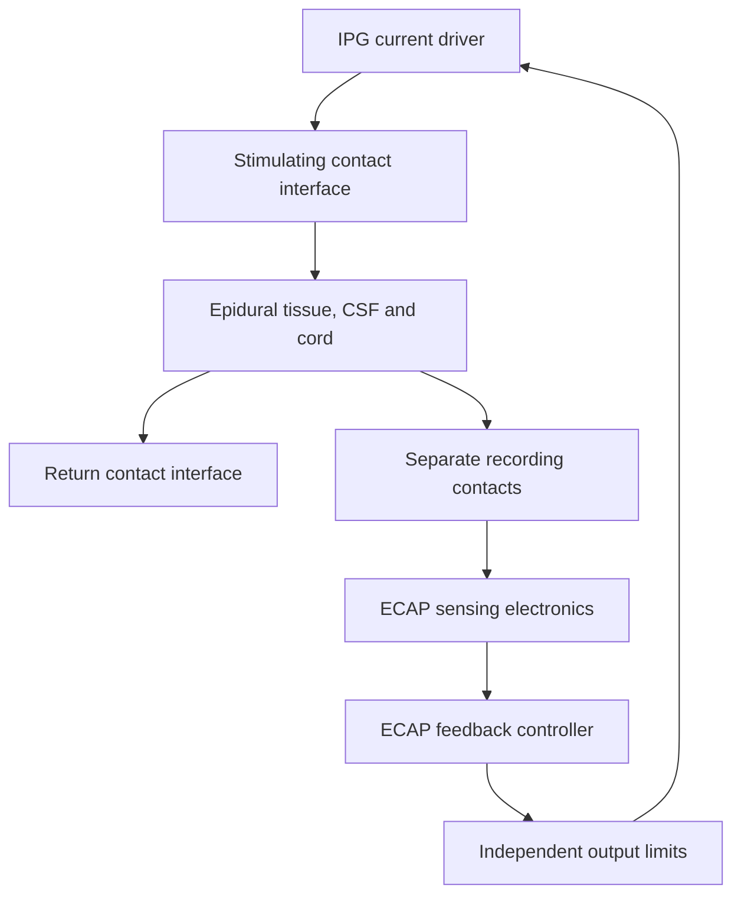

# Electrode and axon pilot results

## Reproduction

Use Python 3.12 with the pinned baseline requirements and NEURON 9.0.2.
Run from the project root. The ModelDB source stays external.

```sh
python -m pip install -r requirements-baseline.txt neuron==9.0.2
git clone https://github.com/ModelDBRepository/3810.git /tmp/bme419-mrg
git -C /tmp/bme419-mrg checkout b15daeda6ea368df0198d257f339cf5e840cf31c
(cd /tmp/bme419-mrg && CC=gcc CXX=g++ nrnivmodl)
python -m scs.electrode.pilot --config configs/material_pilot.toml --output runs/materials
python -m scs.neural.pilot --model /tmp/bme419-mrg --output runs/axon.csv
python -m scs.neural.pilot --model /tmp/bme419-mrg --output runs/axon-fine.csv --dt-ms 0.0025
```

## Materials analysis

Assume a 1 mm² contact and a 3.5 mA rectangular phase lasting 200 µs.
Q = I times phase duration gives 0.70 µC per phase or 0.070 mC/cm².
The charge screen compares this number with the group table's reported
charge-injection values. The measurements represent different geometries
and test conditions. The ratios are illustrative and do not establish safety.
See the [materials review](https://pmc.ncbi.nlm.nih.gov/articles/PMC8257249/)
and [PEDOT:PSS review](https://www.frontiersin.org/journals/neuroengineering/articles/10.3389/fneng.2014.00015/full).

The resistance sweep assumes two equal contact resistances in series with a
tissue load. Terminal voltage is I times total resistance, and energy per
phase is I squared times total resistance times phase duration. At 600 Ω
tissue load, changing each contact from 200 to 50 Ω reduces terminal voltage
from 3.50 to 2.45 V and output energy from 2.45 to 1.715 µJ per phase.
The contact values are sensitivity inputs. A material-specific voltage or
energy result requires matched pulse transients or impedance spectra that
support a dynamic circuit fit. This circuit omits polarization dynamics,
driver losses and battery overhead.

## Axon analysis

Use the published 10 µm, 21-node myelinated axon from ModelDB 3810, with
original morphology and ion-channel parameters. Place a straight fiber at
two white-matter depths and bilinearly interpolate the 1 mA planar field
at all 221 compartment centers. Multiply by signed pulse current and convert
from volts to millivolts for NEURON. Use a symmetric biphasic pulse with
200 µs phases and a 50 µs interphase gap.

The lowest tested current where both end nodes crossed 0 mV was:

| CSF thickness | 0.4 mm depth | 1.5 mm depth |
| --- | ---: | ---: |
| 2.0 mm | 2 mA | 3.5 mA |
| 3.2 mm | 3.5 mA | 8 mA |
| 4.4 mm | 3.5 mA | 8 mA |

All 42 cases agreed on endpoint crossing classification at 5 and 2.5 µs
steps. The largest difference in first crossing time was 80 µs. No endpoint
crossings occurred in the zero-drive controls. Endpoint crossings are a
pilot response metric. Tracking spike onset across interior nodes is needed
to separate propagation from direct activation. These are grid-search
observations for one model diameter and two placements. No ECAP is modeled.

## Design schematic for the report



The series load pilot represents the drive path. The axon pilot takes
prescribed current as input and assumes the driver delivers it. To couple
the two, check compliance and use actual delivered current when a limit
binds. The drawing is a functional schematic. A dimensioned lead and IPG
drawing, material selection, failure-mode analysis, biocompatibility,
classification rationale, and in vitro and in vivo testing plans remain
separate course deliverables.
