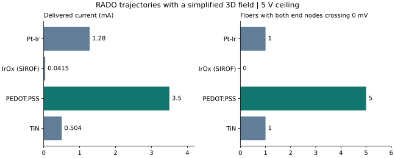

# BME 419 materials comparison using RADO axon paths

## Results

| Material | Estimated voltage for 3.5 mA | Delivered current at 5 V ceiling | Biphasic output energy | Both end nodes crossed 0 mV |
| --- | ---: | ---: | ---: | ---: |
| Pt–Ir | 13.68 V | 1.280 mA | 2.56 µJ | 1/5 |
| IrOx (SIROF charge value) | 422.10 V | 0.041 mA | 0.083 µJ | 0/5 |
| PEDOT:PSS | 3.99 V | 3.500 mA | 5.59 µJ | 5/5 |
| TiN | 34.76 V | 0.504 mA | 1.01 µJ | 1/5 |



## Report-ready interpretation

Under a common 5 V driver ceiling and a requested current of 3.5 mA, the
PEDOT:PSS scenario delivered the full pulse and elicited bilateral
end-node voltage crossings in all five sampled axons. Pt–Ir and TiN each
elicited crossings in one of five axons, and IrOx elicited none. The
lower energy of the other cases reflects reduced delivered current.
The comparison supports PEDOT:PSS as the leading candidate **for pulse
delivery under the stated screening assumptions**. It does not
establish battery-life improvement or an energy ranking at matched
neural response. Under the fixed current distribution in this model,
all candidates would produce the same field and axon response at equal
delivered current. At that matched current, the resistive model predicts
the lowest output energy for the PEDOT:PSS scenario, conditional on the
driver being able to supply the required voltage for each candidate.

## Methods and limitations

The calculation treats the group's nominal 1 kHz impedance magnitude as
effective pulse resistance and scales it by measured area divided by the
assumed 1 mm² design area. Both contacts use the same material. The
circuit assumes a 600 Ω tissue load, a 5 V ceiling, and two 200 µs phases.
Delivered current is the smaller of the requested current and voltage
ceiling divided by the combined load. Pulse energy is twice the phase
duration times current squared times the combined load. The charge
screen uses the reported charge-injection values as context, not as
validated safety limits. Nominal values were taken as the first number
where the table lacked separators. PEDOT:PSS combines a glassy-substrate
impedance and a smooth-coating charge datum. IrOx's unusually high
estimated voltage reflects the 200 kΩ input and this extrapolation.

A bipolar point-source equation in an infinite isotropic medium
(0.15 S/m assumed) calculates extracellular potential at RADO-SCS axon
coordinates. Contact locations are idealized and fixed across materials,
3 mm in x from the center of fiber 1930 and separated by 10 mm in z.
The tissue resistance used by the driver is a circuit assumption,
independent of the analytic field. This is a 3D model using actual RADO
axon trajectories. It has no tetrahedral tissue mesh, tissue interfaces,
or registered STL contacts. Five 10 µm RADO trajectories were cropped
to 21 nodes and driven in NEURON using the ModelDB 3810 axon model.
The endpoint crossing measure does not distinguish propagation from
direct activation. Both time steps (5 and 2.5 µs) gave the same crossing
classification, including the zero-current and ideal 3.5 mA controls.
These five fibers are a sample and do not establish population recruitment
or clinical benefit.

## Reproduce

Keep the [RADO-SCS 3.0 archive](https://zenodo.org/records/3715368) locally.
The runner reads the five required trajectories and diameter data directly
from the ZIP. Commit scripts, documentation, and small result files to GitHub.

Use the [existing NEURON setup instructions](materials_axon_pilot.md#reproduction).
From the repository root, with the ZIP one directory above it:

```sh
python -m scs.neural.rado_material_screen --archive ../RADO-SCS_3.0.zip --model /tmp/bme419-mrg --output runs/material_screen.csv
```

Append `--dt-ms 0.0025` and choose another output path for the finer run.
